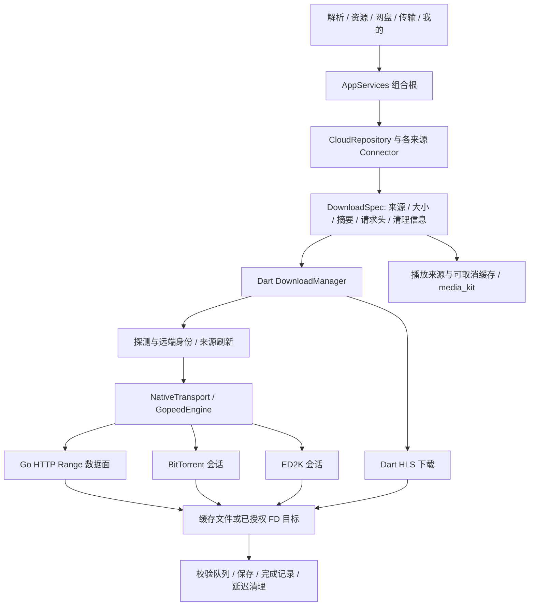

# 文析全项目与下载内核研究

研究日期：2026-11-10。参考提交：[`28e7b4576f5c3a600a44240967c03e21ef579a1f`](https://github.com/z7786/wenxi/tree/28e7b4576f5c3a600a44240967c03e21ef579a1f)。已通过 GitHub 分支接口确认它也是研究时的 `main`，应用源码版本为 `2.2.5+225`。

## 结论

文析值得参考的是**来源策略、任务生命周期、原生文件出口和媒体缓存这一整条协作链**。它的高并发下载由修改过的 Gopeed 1.8.1 执行，Dart 负责取链、失效刷新、排队、HLS、校验及保存。界面里的连接上限不等于所有来源都跑同样并发；接口、账号模式、文件大小和主机背压还会继续约束它。

本轮已直接编译原始 helper，做同源对比、运行其关键 HTTP/恢复测试，并补做跨主机凭据和任务队列实验。文析在受控的每连接限速场景仍快于当前 TurboDL；同时，它也有不能直接带入云取的实现边界。没有依据把公开演示的 122 MB/s 归功于某个未公开的“万能加速接口”，也没有依据声称 TurboDL 已经全面追平。

建议保留云取自己的界面、Kotlin API 和插件边界，按 [ADOPTION.csv](ADOPTION.csv) 的 12 张任务卡独立实现、逐项验收。当前已确认的启动等待和小尾段问题已修进本地维护批次，详见[本批实施记录](../../maintenance/RANGE-AND-REFERENCE-2026-11-10.md)。

## 范围与证据等级

本报告覆盖应用、18 类网盘、Go 下载组件、Android 文件和后台桥接、媒体播放、上传、局域网、资源搜索、动态来源、状态保存、更新与构建。它是项目级架构及关键路径分析，**不把目录清点称为逐行审计，不把本机测试称为全部设备验收**。

- **运行确认**：本机原始 helper、独立 SHA-256、上游选定回归和两项专项实验。
- **源码确认**：已追到实际消费点、调用链或拒绝分支；未使用真实网盘账号调用。
- **文档/入口确认**：模块存在及声明的边界，尚未对该协议或平台运行。
- **待验证**：需要真实账号、移动设备、其他操作系统或稳定态剖析。

索引文件：

| 文件 | 用途 |
| --- | --- |
| [MODULES.csv](MODULES.csv) | 30 个模块的入口、来源行号、经验、对应项目与审查深度 |
| [PROVIDERS.csv](PROVIDERS.csv) | 18 类来源的取链入口、默认连接档与分享能力边界 |
| [SOURCES.csv](SOURCES.csv) | 应用/引擎/测试/平台源码索引、行数、SHA-256 和审查层级 |
| [ADOPTION.csv](ADOPTION.csv) | 独立实现位置、优先级、前置条件和验收要求 |
| [EVIDENCE.json](EVIDENCE.json) | 测试、基准、原始证据位置、专项实验及未验证项 |
| [EVIDENCE.md](EVIDENCE.md) | 实际命令、结果与重现方式 |

`lib/` 有 379 个 Dart 文件、约 12.95 万行，既包含业务也包含较大的页面。`SOURCES.csv` 中未标记关键实现的文件仅做结构归属，不等同于已运行或逐行审查。第三方 `vendor/`、QuickJS、mpv、FFmpeg 等不进行整库逐行重审。

## 1. 架构与真实调用链

`AppServices` 组合网络、账号、临时转存清理、动态来源、下载、上传、媒体和平台服务。业务集中在 Dart，平台差异通过 `NativeTransport`、`FileAccess`、播放及窗口适配器隔离。

Windows/macOS helper 使用带 `seq` 的 stdin/stdout JSON，不把账号信息拼到进程参数；错误和退出会使等待者结束，普通调用有 90 秒兜底。Android 用 MethodChannel → Kotlin → gomobile/JNI，BT 播放才另外使用随机令牌的回环媒体入口。不能把它理解为“所有逻辑都在 Go”。[原生边界源码](https://github.com/z7786/wenxi/blob/28e7b4576f5c3a600a44240967c03e21ef579a1f/lib/platform/native_engine.dart#L73)

## 2. HTTP、并发、写盘和尾段

### 2.1 并发是按来源设定的

普通全局默认 64；夸克直链和 UC 的预设为 512；阿里为 8；百度账号直链预设 3；115 为 16；若干来源为 8。用户覆盖、文件大小、特定来源约束继续生效。夸克来源使用约 64 KiB 的最小分片预算，其余普通来源约 256 KiB，小文件不能凭空得到 512 个有效区间。[设置消费点](https://github.com/z7786/wenxi/blob/28e7b4576f5c3a600a44240967c03e21ef579a1f/lib/domain/settings.dart#L91)、[内核计算](https://github.com/z7786/wenxi/blob/28e7b4576f5c3a600a44240967c03e21ef579a1f/native/gopeed/internal/protocol/http/asterlink_policy.go#L16)

HTTP 原生组件的分片请求有进程级 768、普通主机 512 的共享预算；这不等于探测、播放和所有协议都共用同一上限。阿里、迅雷、光鸭等有额外来源策略。取消可以退出名额等待，排队请求不会先占住全局名额。429/503 的主机冷却与 `Retry-After` 独立于授权失败。**可借鉴的是共享租约和来源策略入口，不是把网盘名称塞进通用 SDK。**

### 2.2 传输与断点

数据按 Range 偏移写入，连接持有自己的分片进度；快照是稳定副本。源地址刷新先暂停旧写入者，再确认远端身份和更新请求。任务 generation 防止旧回调污染同 ID 的新任务。普通远端身份要求尺寸一致，且强 ETag 或 Last-Modified 匹配；只知道长度并不代表能安全续传。[身份判定](https://github.com/z7786/wenxi/blob/28e7b4576f5c3a600a44240967c03e21ef579a1f/lib/domain/downloads.dart#L48)

百度预览会把一次 Range 限在 8 MiB 内，账号直链与阿里还有自己的请求窗口。这说明**断点所有权区间与单次 HTTP 请求窗口可以分开**。TurboDL 以后可开放通用窗口控制，由宿主选择，保留稳定断点网格。

### 2.3 慢尾段是按时间判定的

文析的慢尾段有 750 ms 观察期、约 3 秒 ETA 门限和 500 ms 检查间隔；两半各至少 16 KiB。快速小尾段保留原请求。空闲 helper 可等待变化和取消，等待时不持有 HTTP 请求名额。[完整策略](https://github.com/z7786/wenxi/blob/28e7b4576f5c3a600a44240967c03e21ef579a1f/native/gopeed/internal/protocol/http/asterlink_tail.go)

当前 TurboDL 的小尾段粒度已修正，但仍偏向积极切分。本轮最终普通下载对照中，TurboDL 的请求数明显多于文析，见第 10 节。这是下一项应量化的瓶颈：同时测请求 RTT、剩余 ETA、请求数和尾速，不能只看连接数量。

## 3. 网盘接口与路线

18 个枚举入口不等于 18 个平台都有完全相同的个人、分享、上传与创建分享能力。蓝奏优享和微云当前明确不提供分享解析；部分家庭云和多存储空间也只属于相应平台。[能力来源](https://github.com/z7786/wenxi/blob/28e7b4576f5c3a600a44240967c03e21ef579a1f/lib/domain/models.dart#L65)

关键路线已追踪：

| 来源 | 真实分支 | 对云取的启示 |
| --- | --- | --- |
| 夸克 | 分享接口、可选游客/账号直链、临时转存回退；具体开关控制路线 | 同账号、同文件也可能使用不同取链链路；保存任务路线及账号版本 |
| UC | 游客、Web、授权原文件路线；对视频/带摘要文件核对远端长度 | 防止把预览/转码结果误当用户选择的原文件 |
| 百度 | 公益解析；账号视频走播放路线；账号非视频优先 relay，失败回退本地 preview | 下载与播放应区分，不能把第三方取链能力算成 Go 传输算法 |
| 阿里 | 原文件下载与开放平台播放分别处理；分享有临时转存和清理 | 账号与来源恢复要由宿主负责；稳定文件身份后才保留断点 |
| 123、移动 | 分享转存与个人取链；移动还有家庭云路径 | 文件 ID、目录、账号与家庭空间都需要绑定 |
| 天翼、115 | 来源自己的授权、会话和分享/个人下载协议 | 入口存在不等于可共用所有参数或任意账号实测通过 |
| 光鸭、迅雷 | 分享/个人直链与主机过载控制 | 429/503 共用主机冷却，不能把 401/403 当成并发饱和 |
| 城通、蓝奏、小飞机 | 分享解析/网页或 API 会话、验证码/重定向等不同分支 | 解析成功、取链成功、可下载原文件应分别记录 |
| PikPak、联通、微云、蓝奏优享 | 个人文件及各自支持的分享/转存分支 | 能力表应驱动操作按钮，避免出现未实现的入口 |
| GitHub | 文件、源码归档和发布附件；检查条目/内容变化 | 可以复用通用下载能力，鉴权与分发选择留在应用层 |

百度账号 relay 的客户端会把必要的 Cookie、文件信息和设备参数装入加密请求，发送到构建者配置的服务，再校验返回地址和请求头。加密传输不等于不向服务提供方披露这些数据。仓库里的客户端协议不足以证明我们可以重建同等服务端能力。本轮没有调用对方 relay，也没有向第三方发送账号。[实际构造点](https://github.com/z7786/wenxi/blob/28e7b4576f5c3a600a44240967c03e21ef579a1f/lib/data/providers/baidu_link_service.dart#L40)

阿里开放平台播放另外使用 OpenList OAuth 服务；这与阿里原文件下载是不同路径。云取采用任何类似服务前，都应把数据去向、权限和授权过程作为独立功能处理，不能暗中替换已有账号路线。

## 4. 队列、后台、保存与空间

`DownloadManager` 区分网络活动与校验/保存活动。网络完成先停止写入者；等待后处理期间可以调度下一个网络任务。它分别记录 `verifyMs`、`postQueueMs`、`saveMs`，保存成功才标记完成，清理失败另留待办。

Android 的 direct output 由宿主预建目标，再授予带 lease 的文件描述符；原生写入前验证绑定。校验留在原生 IO 线程，用 256 KiB 缓冲读 FD，不逐块跨 Flutter 桥回传。发布顺序包含 fsync、publishing 日志、MediaStore 可见状态和完成日志；进程重启可识别下载已完成但发布未完成的状态。[目标生命周期](https://github.com/z7786/wenxi/blob/28e7b4576f5c3a600a44240967c03e21ef579a1f/android/app/src/main/kotlin/com/asterlink/app/download/DownloadTargetStore.kt#L143)

云取当前 `TurboDownloadManager` 仍先写应用缓存，再由 `DownloadSaver` 保存到公共目录。值得优先测的是大文件收尾的二次完整复制，以及校验/保存是否阻挡后续任务。**更换网络语言不能消除这一层拷贝。** 可先增加分阶段指标，再用可选文件目标适配器做收益实验，保留原有 File 出口。

空间预算按卷分别预留，考虑已下载数据、缓存、跨盘导出及 32 MiB 安全余量，进行中按消耗扣减。后台用 Android 前台服务和资源保护模块，通知不暴露全部任务详情；物理手机的厂商后台行为未在本轮运行。

**原生任务队列已实测**：同一个原始 helper 提交 4 个单连接任务，阻塞前三个响应体时仅 3 个在传，释放后 4 个全部完成且 SHA-256 正确。源码 `AppSettings.maxConcurrentDownloads=32` 与 `openStorage` 的 `MaxRunning=3` 是两层不同上限。不能把界面允许设置 32 当作 Go 正在同时下载 32 个文件，也不能在没有产品约定时直接把该差异定为漏洞。

## 5. HLS、BT 与 ED2K

### HLS

Dart HLS 下载支持 VOD、选择带宽变体和单个 init map，按分片顺序保存。解析器明确拒绝加密、ByteRange 和直播；带独立音轨的变体也会转为在线播放提示。不要把 mpv 的播放能力等同于 HLS 下载器已经实现这些格式。[解析器及拒绝分支](https://github.com/z7786/wenxi/blob/28e7b4576f5c3a600a44240967c03e21ef579a1f/lib/download/hls.dart)

TurboDL 当前已有 AES-128、ByteRange、单前置 fMP4 map 和并发分片下载；本批还改为流式 AES、复用缓冲与有界密钥预取。这一部分应保留现有路线，继续补其自身的边界与资源测试。

### BT

沿用 anacrolix，元数据解析、文件选择、下载和媒体会话分别管理；声明最多 80 个 peer、单 BT 文件队列、播放时调整带宽优先级。元数据包含文件数、深度、路径与分片尺寸边界；媒体只在分片验证后提供给本地读取者。种子和 tracker 的实际公网可用性、不同平台资源成本本轮未测试。

### ED2K

在现有 Go 运行库内适配 Kelpie，保留 MD4/AICH、服务器/Kad、来源交换、断点与保存队列，首次使用才启动网络。它扩展的是协议能力，不是 HTTP 网盘的提速开关。移入 TurboDL 时应独立模块、共享资源预算并按原许可处理；本轮仅研究适配边界，没有接入生产。[明确来源及补丁](https://github.com/z7786/wenxi/blob/28e7b4576f5c3a600a44240967c03e21ef579a1f/native/gopeed/internal/ed2kcore/ASTERLINK_PATCHES.md)

## 6. 播放器与缓存

媒体使用 `media_kit`/mpv 和项目适配层。应用层做来源刷新、字幕、播放列表、续播、画中画、外部播放器、投屏和睡眠定时；关闭时等待相关会话与 IO 退出。

普通视频的本地 Range 代理会探测支持情况，按播放位置安排分片，seek 时取消旧读取，按需求/所有者淘汰缓存；m3u8/mpd 不走同一普通文件代理。缓冲策略区分手机和桌面，名义预算分别为 96 MiB、320 MiB，不能直接把这两个数当作整个播放器 RSS。

可借鉴“已下载区间给播放器复用”与“跳转取消旧预取”，但不应该为增加一个视频按钮就引入所有 mpv/FFmpeg、投屏和桌面窗口依赖。先审计云取现有播放路径，再逐功能做首帧、seek、缓存重复字节、内存和退出测试。

## 7. 上传、文件管理、互联与搜索

上传有自己的队列、递归目录、重试/取消、目标创建与进度控制。文件浏览支持分页、排序、账号/家庭空间、文件操作和批量收集。它们应由来源能力决定是否开放，不能复制菜单后保留无实现的按钮。

局域网互联有发现、配对、令牌会话、浏览器文件分享、Range 读取及反向链路；服务器约束 LAN 地址、Host、Origin、请求大小、活动数和会话有效期。这是单独的传输功能，不能混入公网下载加速结论。

资源搜索由签名目录/规则、设备端站点与公开频道搜索、后台补搜和链接有效性检测组成；与网盘账号会话分开。只读有效性检测不代表每个子文件可下载。云取可参考可取消搜索、渐进追加结果、后台暂停探测与来源能力说明，资源池或第三方服务应另行设计。

## 8. 动态来源、状态与应避开的实现

### 值得保留的边界

来源目录用 RSA-SHA256 和包摘要，限制版本、有效期、包体和模块数。QuickJS 通过 isolate 执行；限制 JS 堆/栈、单次执行、累计执行、宿主请求次数和响应大小。32 MiB 是 JS 堆上限，并非整个进程预算。

来源的 API 和下载域名分别授权。权限会传给原生数据面，检查协议/端口/全部 DNS 结果和逐跳重定向；跨源敏感头移除后不会因跳回原域重新恢复。签名目录只证明发布者和完整性，宿主网络限制仍不可省。

### 运行确认：普通 HTTP 终址缓存重新携带凭据

两台本地服务分别使用 `127.0.0.1` 和 `localhost`。给原始请求传入虚构 Authorization、Cookie 和自定义 key，运行未经修改的 helper、通用来源且不提供 `sourceNetworkPolicy`。结果：

| 请求 | Authorization | Cookie | 自定义 key |
| --- | --- | --- | --- |
| 首次探测经过 302 到另一主机 | 已移除 | 已移除 | 仍存在 |
| 首个数据 Range 经过 302 | 已移除 | 已移除 | 仍存在 |
| 复用缓存终址的数据 Range | **重新存在** | **重新存在** | 仍存在 |

原因链是 `fetcher.go` 缓存终址，`buildRequest` 为终址重新装入原始 `ReqExtra.Header`，绕开“本次发生重定向”的标准处理。带 source network policy 的动态来源另走受限 client；本结论不能外推成它所有分支都忽略权限。实验仅使用虚构凭据和本机流量，完整文件 SHA-256 正确。

云取/TurboDL 继续保留自己的跨 origin 凭据隔离与原始来源标签，复用终址也要检查。无需复制这一处实现。

### 源码确认：当前 Dart 状态是明文校验和 JSON

`StateStore` 当前写 `state-v2.json`，封套为 `asterlink-state-v2 + sha256 + data`；`Vault.putCredential` 将 credential JSON 放入同一状态树。SHA-256 校验和不提供保密性，也不能阻止能改文件的主体重算校验和。原生 bbolt 的加密是另一层，不能因此说 Dart 状态也加密。

这是当前源码和明文迁移测试明确采用的设计，不应从旧性能文档推导“所有本地数据仍加密”。云取已有 Android Keystore 凭据加密与密钥丢失处理，应保留。其余全快照改写的复杂度和 IO 成本也需留意；云取已有 Room，不应为模仿而改为全量 JSON。

项目还包含可选供应商统计模块，默认授权行为需要按构建和实际隐私流程另验；它不是下载器必需依赖，本轮没有向云取增加统计 SDK。

## 9. UI 与多平台：学习职责分离

界面以五个主入口组织业务，820dp 切换导航栏/侧栏，页面保活并分别监听状态。主题区分明暗、玻璃/磨砂/实色和字体比例；shader 在低功耗、高对比、TickerMode 关闭或不支持时降级，程序/资源有复用与释放。值得借鉴的是性能降级和功能能力边界，视觉、图标和品牌继续采用云取自己的设计。

| 平台 | 源码/构建情况 | 本轮证据 |
| --- | --- | --- |
| Android | Flutter + Kotlin、gomobile AAR、原生文件/后台适配 | 静态链路审查；未构建 AAR/APK，未做手机运行 |
| Windows | Flutter runner + Go helper + C++ 平台桥 | helper 实际构建、下载、恢复、队列及凭据实验 |
| macOS | Swift runner、Go helper、Intel/ARM 构建工作流 | 阅读入口和工作流；未在 macOS 构建/运行/签名 |
| iOS | Swift 平台外壳和原生框架构建材料 | 入口清点；未在 Xcode/设备验收 |
| Linux | 仓库未提供对应 Flutter Linux runner | 不宣称完整应用支持；Go 可移植性不等于应用已适配 |

本机 Flutter 3.47.8 / Dart 3.13.7 满足声明的 SDK 版本，但隔离副本离线解析依赖因缺 `pinyin` 失败。没有临时删除它的依赖去伪造测试通过，也没有下载额外 SDK 或启动模拟器。因此不声明 Flutter 单测/界面运行成功。

## 10. 实测结果与局限

### 原项目回归

固定源码，Go 1.25.7，Windows x64，vendor 依赖：HTTP 9 个顶层测试通过，另含 4 个子用例；恢复 4 个顶层测试通过，另含 4 个子用例。没有失败或跳过。另有任务队列和跨主机头专项实验，各完成真实文件并验证 SHA-256。

这些是所选边界的验证，不是整个 Gopeed、BT、ED2K、Flutter 或所有账号测试全绿。

### 本批 TurboDL A/B

相同 JVM、磁盘、源端内容和连接数，AB/BA 交错，每侧预热，最终扩展到 9 组：

| 场景 | 基线 p50 | 候选 p50 | 证据结论 |
| --- | ---: | ---: | --- |
| 1 MiB、响应体延迟 240 ms、8 路 | 826 ms | 619 ms | 观测 1.33x；CV 超15%，不作为稳定倍数承诺 |
| 48 KiB、2 路、慢首段 | 1038 ms | 695 ms | 观测 1.49x；基线有高波动，另有确定性行为回归 |
| 32 MiB 不限速、16 路 | 641 ms | 618 ms | 波动较大，配对区间跨1；不能宣称提速或稳定非退化 |
| 16 MiB、每连接200KiB/s、64 路 | 2034 ms | 1856 ms | 约 1.096x；两侧CV低于15%，配对95%区间约1.084–1.219 |

先行的两项专测分别得到 1.40x、1.61x 且 CV 低于15%；最终宽矩阵明确保留其波动情况，避免只选择最好的一轮。

### 当前 TurboDL 与文析原始内核

| 场景 | TurboDL p50 | 文析 p50 | 判断 |
| --- | ---: | ---: | --- |
| 32 MiB 不限速、16 路 | 757 ms | 287.76 ms | 文析观测更快，但波动超过门限；不作稳定2.63x结论 |
| 16 MiB、每连接200KiB/s、64 路 | 1888 ms | 1372.98 ms | 文析约1.375x；两侧CV约5.0%/4.3%，仅限该受控模型 |

64 路时双方源端活动处理器峰值均为 64；TurboDL 请求数中位数为 289，文析为 65。不限速档分别约116与18。这是请求策略和尾段成本值得继续改进的证据，不能靠增大 UI 数字解决。

以上包含各自任务准备、探测和收尾，JVM/进程总耗时另存 `wall_ms`；文析还含20ms状态轮询，TurboDL包含冷代码/JIT开销。它们不能直接代表常驻 Android SDK 的稳定态或真实网盘/CDN速度。公开视频的账号、会员、接口、设备、网络和缓存条件未统一，本轮不能声称已复现其122 MB/s。

最终宽矩阵及竞品对照共108个测量样本、12个预热样本，全部独立SHA-256正确；测试载荷逐次删除，无公网文件下载。原始证据和冻结构件留在D盘，机器可读结果见 `EVIDENCE.json`。

## 11. 云取与 TurboDL 的落地顺序

1. **先把现有链路测准**：保留 aria2 参数/恢复统计修复；在云取日志中区分来源路线、取链、首字节、传输、校验、保存、清理、实际连接与用户上限。不得输出凭据。
2. **优先做有证据的网络成本优化**：尾段 ETA/RTT 判定、请求窗口与断点网格分离、跨任务/插件/多个 client 的共享主机租约。维持自适应，并由宿主声明来源政策。
3. **改善大文件使用体感**：校验/导出分队列，原生授权目标作为可选路径，按卷预算，避免完整二次复制；强杀、满盘和撤权时保留可恢复状态。
4. **补齐插件与媒体功能**：核对已有签名和权限链，按需加入协议插件、已下载区间复用、续播、睡眠定时和字幕。每项独立开关、完整回调及资源验收。
5. **最后扩展产品功能**：上传、家庭云、局域网互联和资源搜索按需求逐项接入；UI沿用云取自身风格，Windows客户端开发继续暂停。

每张任务卡都有真实入口、参考模块和验收要求。已有实现先做差分审计，性能候选经同条件A/B证明收益再启用；发布前再跑全量门禁。没有把这份研究当作所有功能已实现，也没有将原生语言本身当作收益证据。

## 12. 源码与许可边界

仓库声明应用原创/适配代码为 AGPL-3.0-only，修改后的 Gopeed 为 GPL-3.0，嵌入 Kelpie 保留 MIT及相关声明，媒体和插件各有自己的许可。具体来源以其 LICENSE 和第三方说明为准。[项目许可说明](https://github.com/z7786/wenxi/blob/28e7b4576f5c3a600a44240967c03e21ef579a1f/docs/LICENSING.md)

本轮只在隔离目录编译、执行和研究原始代码；对 TurboDL 的修改为独立编写的通用启动/切分修复。没有导入文析的实现文件、图标、界面素材、供应商统计、私有服务配置或账号数据。后续按任务卡独立设计，新增依赖单独核对，不把更换文件名或翻译代码当作独立实现。
